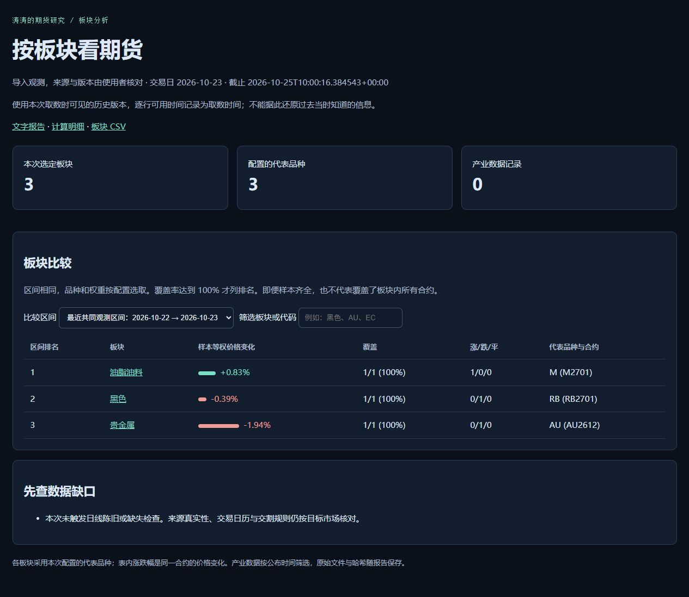

# 涛涛的期货研究

按板块做期货分析，先看分化，再看具体品种。

我把研究分成板块比较、产业数据和价格结构三步。脚本按同一起止日期比较固定合约，点进板块后再看量仓、跨月曲线、多周期和人工关键位。输入文件、运行命令和结果放在一起，方便照着算、重新跑。

## 一个仓库就能运行

准备 Python 3.10 及以上版本，程序只用标准库。

```bash
git clone https://github.com/Serennity007/taotao-futures-research.git
cd taotao-futures-research
python scripts/run_sectors.py --config examples/sector-demo/config.json --out output
```

打开终端打印的 index.html。你可以切换比较区间、筛选板块或代码，再进入各板块页面。报告同时保存 Markdown、JSON、CSV 和本次输入，重复运行会保留旧记录。

先看 [已运行的模拟报告](examples/sector-workbench/REPORT.md)，或者按 [实操步骤](docs/sector-hands-on.md) 手算核对。这份练习为模拟数据；目录收录69个品种标识，演示选30个代表品种，覆盖11个研究板块。另有 [公开日线取数实测](examples/real-source/VERIFICATION.md) 和 [两次记录对照](examples/review-result/REVIEW.md)。

[模拟板块报告截图](.github/sector-preview.jpg) 展示完整的11板块练习。

## 用公开日线跑一份报告

```bash
python scripts/fetch_sina.py --request examples/sina-request.json --out output/sources --analyze
```

这个命令只请求文件里明确填写的合约，一批最多6个。取数、保存原始响应、转换字段和生成报告会按顺序完成；默认的模拟报告命令仍然离线运行。

2026-10-25 实测 AU2612、RB2701、M2701，分别取得225、184、183条日线，最近共同日期为2026-10-23。它们是本次选择的固定合约，不自动称为主力。原始响应、取数时间、输入和哈希已保存，可看 [真实快照报告](examples/real-workbench/REPORT.md)。

这里使用的是下载时可见的历史版本。每根 K 线记录 available_at，不能把今天取到的数据回填成过去当时已知的版本。取数当日的日线会排除，日收盘时刻由请求文件声明。具体字段和源站变化的处理见 [取数说明](docs/public-data.md)。

下面是本次3个固定合约的取数快照，终点为2026-10-23收盘，保留来源与版本说明：



## 检查快照，再做复盘

```bash
python scripts/bundle_integrity.py examples/sector-workbench
python scripts/bundle_integrity.py examples/real-source
python scripts/compare_reports.py --before examples/review-before --after examples/review-after --out output/reviews
```

新版报告校验输入、配置、页面与表格的 SHA-256。重跑冻结配置时会先校验，文件改动就报出。校验检查文件一致性，来源真实性仍需核对。

两次记录对照按同一合约计算价格变化；换月、单位变化、窗口起点变化或样本缺失会单独说明。改过人工关键位或参照柱，也会留下条件变更记录。[模拟复盘](examples/review-result/REVIEW.md) 演示一个先满足收回/回踩观察、后来触及失效位的条件。

## 按板块查资料

| 板块 | 目录中的品种标识 |
|---|---|
| [贵金属](references/sectors/precious-metals.md) | AU, AG |
| [有色与新能源材料](references/sectors/nonferrous.md) | CU, AL, ZN, PB, NI, SN, AO, BC, LC, SI |
| [黑色](references/sectors/ferrous.md) | RB, HC, I, J, JM, SF, SM, SS |
| [能源](references/sectors/energy.md) | SC, FU, LU, PG, BU |
| [化工](references/sectors/chemicals.md) | TA, MA, EG, EB, L, PP, V, PF, PX, SH, UR, FG, SA, RU, NR, BR, SP |
| [油脂油料](references/sectors/oilseeds.md) | A, B, M, Y, P, OI, RM, PK |
| [谷物与养殖](references/sectors/grains-livestock.md) | C, CS, RR, JD, LH |
| [软商品与特色农产](references/sectors/softs.md) | CF, CY, SR, AP, CJ |
| [航运](references/sectors/shipping.md) | EC |
| [股指](references/sectors/equity-index.md) | IF, IH, IC, IM |
| [国债](references/sectors/rates.md) | TS, TF, T, TL |

这是我按研究用途划的分类。例如股指和国债分开，建材和橡胶放在化工大类，具体分析再拆产业链。品种目录用于匹配输入文件，当前挂牌、活跃合约与交易规则仍按交易所资料核对。

## 报告里看什么

- **板块比较**：共同区间的等权价格变化、上涨/下跌数量、代表品种覆盖率。缺数据就显示缺口，默认样本齐全才排名。
- **单品种**：固定合约的价格、与前次观测的量仓变化、前5根日线均量对比、ATR14，保留前次观测日。
- **价格结构**：日线、H4、H1/M30 的均线与 MACD，人工支撑/阻力、参照柱计数和窗口到期。
- **产业数据**：观测期、公布时点、数值、单位和来源；截止时刻之后才公布的版本不进入旧报告。
- **跨月曲线**：按交割月比较价差，保留报价时间差，检查币种和单位。

这些是观察与计算。每个板块页面列出下一步应查的供需、库存、成本和事件资料；当价格与解释不一致时，把分歧留下来。

## 这套价格方法怎么用

[完整方法](references/price-structure.md) 整理了大周期背景、H4 边界、H1/M30 触发，以及区间边缘、跌破收回、突破回踩、时间窗口和风险预算。

先写观察条件，再等收盘和后续回踩。参照柱与验证期限事先确定；到期没有发生，就在复盘里记录。可以为品种填写事先声明的 setups：参照柱、边界、再次测试容许范围、验证柱数和失效位。程序分别记录收回、后续测试、过期和失效，收回那一根不能同时算成后续回踩。条件的人工声明时间与来源仍需保留，观察满足不等于交易优势已验证。风险手数另需合约与成本资料。

[板块比较口径](references/sector-workflow.md) · [事件传导](references/event-transmission.md) · [数据与计算格式](references/data-contract.md) · [结构条件与复盘](docs/rules-and-review.md) · [官方入口](references/sources.md)

## 换自己的数据

复制 `examples/sector-demo/config.json`，在 universe 里选实际合约，修改共同交易日、区间、币种和单位。将 data_kind 改为 imported_observations，为每个使用的输入文件填写来源名称和取数时间。

panel.csv 提供价格、成交量和持仓量；evidence.csv 与 curves.csv 可选。具体字段和手算过程见 [实操文档](docs/sector-hands-on.md)。导入标签只是输入类型，数据来源与历史版本需要核对。

## 作为 Skill 使用

这个仓库根目录就是总 Skill，入口是 [SKILL.md](SKILL.md)。把完整目录放进你使用工具的技能目录，保留名称 `taotao-futures-research`。

```text
使用 $taotao-futures-research，按板块分析我提供的期货数据，截止时间为……。
先检查共同区间和覆盖率，再研究板块内分化，结合已公布产业数据和多周期结构。
保存报告，写清待确认条件、失效条件和下一次检查事件。
```

## 四个专题仓库

[黄金](https://github.com/Serennity007/gold-research-skill) · [原油](https://github.com/Serennity007/crude-oil-research-skill) · [欧线 EC](https://github.com/Serennity007/ec-shipping-research-skill) · [大 A 股指](https://github.com/Serennity007/a-share-index-research-skill)

它们保留各自更细的计算和例子，总 Skill 可以独立运行。原来的四报告联合演示仍可用，命令见 [旧版四报告用法](docs/four-specialists.md)。

## 检查和重跑

```bash
python -m unittest discover -s tests -v
python scripts/run_sectors.py --config 旧报告目录/config.snapshot.json --out output
```

把“旧报告目录”换成实际路径。输入快照不依赖原文件位置，测试检查共同日期、缺失样本、公布时间、换月隔离和报告重跑。

[研究和复盘写法](docs/research-playbook.md) · [A 股选股与量化工具](https://github.com/Serennity007/awesome-stock-quant-skills)

[Serennity007](https://github.com/Serennity007) · MIT
